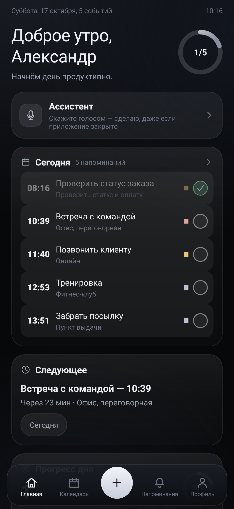
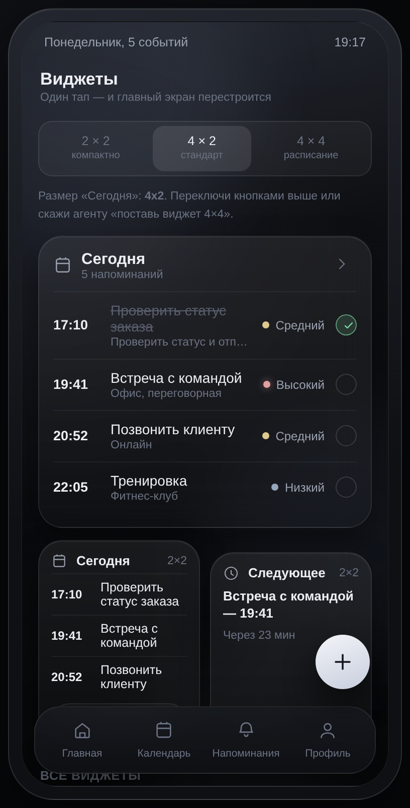
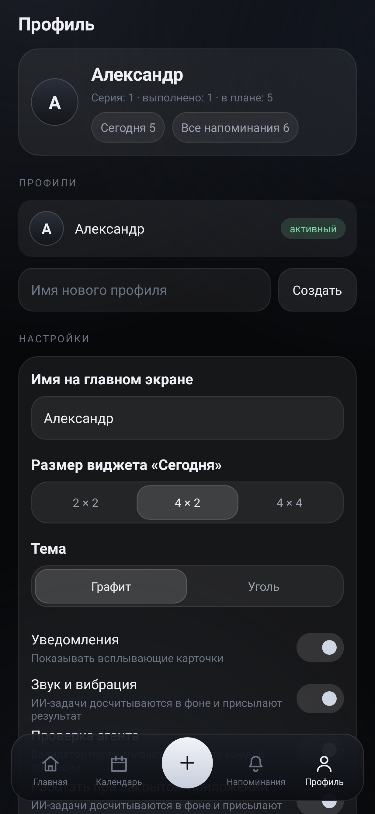

# Memento — напоминания, виджеты и голосовой ИИ-агент

Нативное Android-приложение (Kotlin, минимум зависимостей) — мобильная версия сайта Memento:
тёмный «стеклянный» интерфейс, напоминания с точными будильниками, красивые уведомления,
домашние виджеты и голосовой ассистент, который выполняет просьбу, даже если приложение закрыто.

  

## Что умеет

* **Напоминания.** Дата, время, повтор (каждый день / по будням / неделя / месяц), место, заметки,
  приоритет, «уведомить за N минут». Точные будильники (AlarmManager) + восстановление после
  перезагрузки, перевода часов и обновления приложения.
* **Уведомления.** Свой макет (RemoteViews) в стиле сайта: заголовок, «Memento · Через 23 мин»,
  место, кнопки «Отложить» и «Выполнено». Отдельный канал для задач ассистента.
* **Виджеты рабочего стола.** «Сегодня» (список дел, 4×2), «Следующее» (что скоро), «Прогресс дня»
  (круговой прогресс 2×2). Тап по пункту открывает напоминание, тап по галочке — закрывает.
* **Голосовой ассистент.** Микрофон → распознавание речи (ru-RU, в том числе офлайн) → разбор
  фразы → действие: создать, перенести, отложить, отметить выполненным, удалить, показать планы,
  переключить виджет или настройку. Работает и без интернета: локальный разборщик русского текста.
* **ИИ через OpenAI-совместимый API.** В профиле указывается base URL (по умолчанию
  `https://api.xkiro.com/v1`), модель (по умолчанию `qwen/qwen3.5-flash:free`) и ключ — он хранится
  на устройстве и нигде не зашит в код. Если ключа нет или сеть недоступна, работает локальный движок.
* **Работа при закрытом приложении.** Очередь задач сохраняется на диск; foreground-служба доводит
  задачу до конца, показывает прогресс в уведомлении и результат. После перезагрузки очередь
  поднимается заново (BootReceiver).
* **Оптимизация.** release APK ≈ 2,4 МБ, без Compose/Room/OkHttp (только core-ktx, appcompat,
  material, recyclerview, coroutines), minSdk 24 — от Android 7.0 до свежих версий, R8 + shrinkResources.

## Экраны

Главная (приветствие, кольцо прогресса, карточки «Сегодня», «Следующее», «Прогресс дня»),
Виджеты (2×2 / 4×2 / 4×4), Календарь (сетка месяца, фильтры), Напоминания (центр уведомлений),
Профиль (имя, тема, ИИ, разрешения), Ассистент (чат, примеры фраз, микрофон),
лист «Новое напоминание» с быстрыми чипами дат и колесом времени.

Нижняя панель: четыре вкладки, ровно по центру — кнопка «+» (новое напоминание).

## Сборка

```bash
# локально (нужен JDK 17 и Android SDK)
gradle assembleRelease        # подписанный, оптимизированный APK
gradle assembleSafe           # тот же код без R8 — запасной вариант для капризных прошивок
gradle testDebugUnitTest      # 66 проверок: логика, разбор фраз, вёрстка, структура
python3 tools/check_resources.py        # все ссылки на ресурсы на месте
python3 tools/check_ui_screenshots.py   # вёрстка по пикселям (нужен pillow)
```

Ключ подписи: `keystore/memento.jks` (создаётся в CI, пароль по умолчанию `memento-pass`,
переопределяется переменными `MEMENTO_STORE_PASSWORD`, `MEMENTO_KEY_PASSWORD`, `MEMENTO_KEY_ALIAS`).

Готовые файлы после сборки: `apk/app-release.apk` и `apk/app-safe.apk`, отчёт — `ci-report.txt`.

## Как проверяется, что всё на месте

1. **Логика и данные** — 66 юнит-тестов (Robolectric + JUnit): разбор русских фраз и дат,
   хранилище и его сохранение в файл, путь «фраза → план → действие → проверка», очередь задач,
   структура манифеста и целостность всех XML-ресурсов.
2. **Геометрия интерфейса** — тесты вёрстки: «+» строго по центру, четыре вкладки симметричны и с
   равным шагом, галочки и переключатели выровнены по одной оси.
3. **Пиксели** — `tools/check_ui_screenshots.py` разбирает нарисованные экраны и проверяет центр
   кнопки, шаг вкладок и видимость галочек.
4. **APK** — `tools/verify_apk.py` читает собранный манифест и проверяет пакет, SDK, разрешения,
   компоненты, разметку виджетов и подпись.

## Разрешения

Интернет (только для вашего же API), уведомления, точные будильники, вибрация, автозапуск после
перезагрузки, микрофон (по кнопке), foreground-служба для фоновых задач, отключение оптимизации
батареи (по желанию, для надёжных напоминаний).
